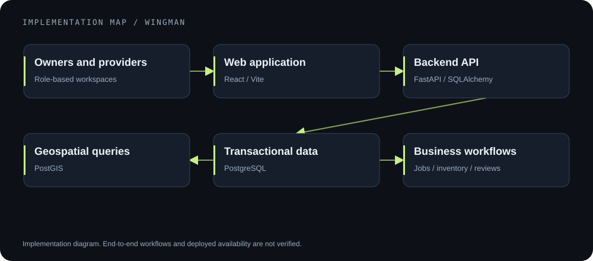
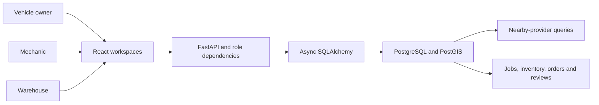

# Wingman

     

**A roadside-assistance workspace connecting vehicle owners, mechanics, and parts suppliers through geospatial discovery and service workflows.**

Previously named **RoadAssist**; that name remains in backend identifiers and technical reports. The repository URL is unchanged.

[Architecture](#architecture) · [Setup](#local-setup) · [Database](#database-design) · [Technical reports](#technical-reports)

## The problem

A breakdown is a coordination problem: finding a suitable provider, describing the job, checking parts, and following progress. Wingman brings those interactions into role-specific web workspaces backed by a relational and geospatial data model.

**Status:** full-stack application prototype. The frontend builds; a complete running database-backed workflow and production availability were not established by the portfolio audit.

## Implemented scope

- Owner, mechanic, warehouse, and administrator interfaces.
- Nearby provider and parts discovery using PostgreSQL/PostGIS queries.
- Service requests, job status, inventory, orders, reviews, and related workspace APIs.
- JWT authentication, password hashing, and role dependencies in the FastAPI backend.
- SQL procedures, triggers, views, and schema scripts supporting transactional workflows.

## Architecture





*Implementation illustration, not a screenshot or a guarantee that every workflow has been integration-tested.*

## Database design

The [primary schema](database/schema.sql) includes spatial data, business entities, job acceptance logic, rating/stock triggers, and analytical views. [Incremental SQL scripts](database/) record subsequent schema additions.

Important tradeoffs:

- **PostGIS** keeps nearby-search logic close to the stored spatial data.
- **Database-side procedures and constraints** express transactional rules centrally; their behavior still needs validation against a disposable database.
- **Role-based APIs** separate user workflows. Enabling RLS does not itself establish row isolation when the application connects as the database owner.

## Local setup

Prerequisites: Python 3.12, Node.js compatible with the frontend's Vite version, and PostgreSQL with PostGIS. Use an isolated local database.

```bash
cp backend/.env.example backend/.env
cp frontend/.env.example frontend/.env.local
```

Set a local `DATABASE_URL` and generate a new `SECRET_KEY` for your environment. Initialize your **empty local database** using [schema.sql](database/schema.sql), then optionally [seed.sql](database/seed.sql). These scripts write data; never point a demo at an existing university or production database.

```bash
# Backend: after configuring the isolated database
cd backend
python -m venv .venv
source .venv/bin/activate
pip install -r requirements.txt
uvicorn app.main:app --host 127.0.0.1 --port 8000 --reload
```

```bash
# Separate terminal, from the repository root
cd frontend
npm ci
npm run dev
```

The frontend uses `VITE_API_URL`; the backend uses the variables documented in its example file. Compose is an alternative local configuration; inspect [docker-compose.yml](docker-compose.yml) before starting it.

**Startup caveat:** `AUTO_BOOTSTRAP_SCHEMA=false` currently gates only part of bootstrap logic. Other schema installers still execute on startup. The documentation does not change this behavior; use a disposable database.

## Verification and current boundaries

- The audited frontend production build passed at `1fbd601`.
- The configured ESLint check reported 23 errors and 15 warnings; TSX files are outside its current JS/JSX pattern. A Vite build is not a full type check.
- No automated application test suite was found. Complete authorization, inventory concurrency, and job lifecycle behavior remain unverified.
- Multiple generations of UI pages remain in the tree. The current routing uses the Wingman workspace alongside retained earlier components.

```bash
cd frontend
npm run build
npm run lint
```

These commands are available checks, not a claim that both currently pass.

## Technical reports

[Deployment notes](DEPLOYMENT.md) · [Demo checklist](DEMO_CHECKLIST.md) · [Project report](RoadAssist_Project_Report.md) · [Technical code report](RoadAssist_Technical_Code_Report.md)

The reports describe the project's design history. Use the current source and setup instructions as the authority where names or layouts differ.
