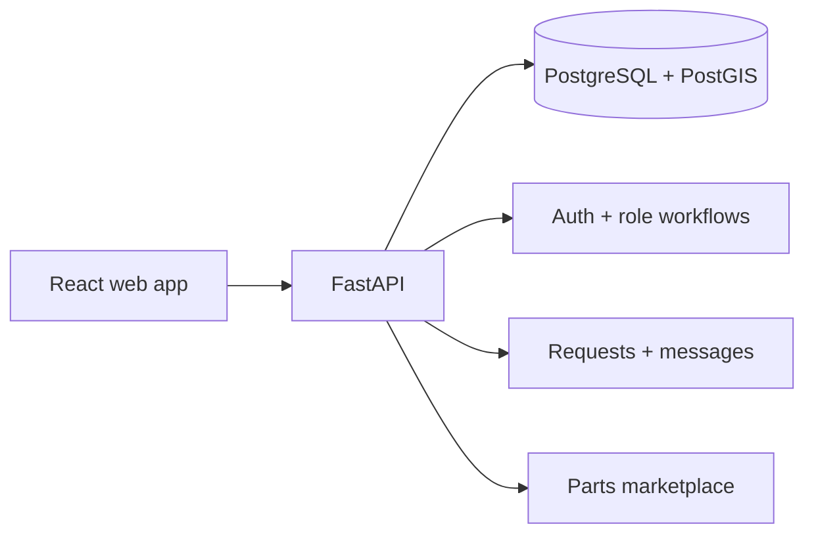

     

<strong>A full-stack roadside-assistance marketplace for service requests, nearby mechanics, inventory, messaging, and job coordination.</strong>

## Overview

A full-stack roadside-assistance marketplace for service requests, nearby mechanics, inventory, messaging, and job coordination.

### Why it matters

Wingman brings the fragmented roadside-help journey into one location-aware workspace for drivers, mechanics, and parts providers.

## Key features

- Role-based driver and mechanic workflows
- PostGIS-powered nearby service discovery
- Service-request lifecycle and messaging
- Parts marketplace and warehouse inventory

## Architecture

## Technology stack

**react** · **fastapi** · **postgresql** · **postgis** · **sqlalchemy** · **docker**

## Getting started

Configure `backend/.env` and `frontend/.env.local` from the examples, initialize a disposable PostgreSQL/PostGIS database, start FastAPI, then run the Vite frontend. Use synthetic records for demos.
