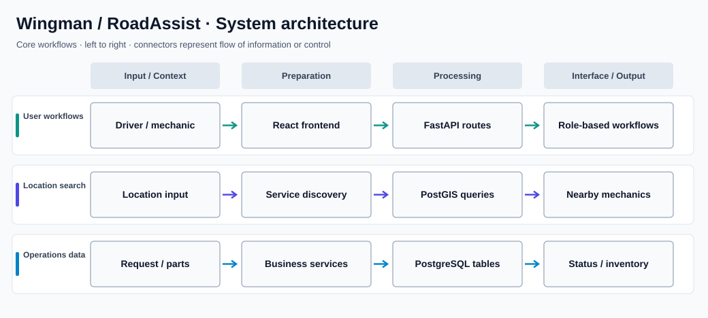

# Wingman / RoadAssist

**Full-stack roadside assistance and parts marketplace**

## Overview

Wingman, implemented as RoadAssist, connects stranded drivers with nearby mechanics and a parts marketplace. Its full-stack architecture combines a React client, a FastAPI backend, and a PostgreSQL/PostGIS database to support location-aware discovery, service requests, messaging, and inventory workflows.

### Why this project matters

Roadside assistance is a coordination problem involving the driver, mechanic, and parts provider. The project brings those interactions into one application with role-specific capabilities and location-aware searching.

## Key capabilities

- Supports driver, mechanic, and administrative workflows with role-based access.
- Uses PostGIS for nearby mechanic and service discovery.
- Manages roadside service requests and their status changes.
- Includes messaging and service coordination capabilities.
- Supports parts listings, inventory, and marketplace workflows.
- Maintains relational data and geospatial queries in PostgreSQL/PostGIS.
- Provides separate frontend and backend environments for local development.

## System architecture



The diagram organizes the major flows into aligned lanes to make their responsibilities and handoffs clear. It is a high-level view; individual modules may also communicate across lanes.

### How it works

The React application presents role-specific screens and communicates with FastAPI. Backend routes enforce authentication and workflow rules and read or write structured records in PostgreSQL. PostGIS supports geographic lookups, while inventory and request-related tables support service coordination.

Local development can run each application component separately or through Docker Compose. The `database/` scripts provide the schema and sample records for a disposable environment.

## Technology stack

| Technology | Purpose |
| --- | --- |
| **React / Vite** | Web application and client navigation |
| **FastAPI / Python** | Backend services and REST endpoints |
| **SQLAlchemy** | Database access and models |
| **PostgreSQL / PostGIS** | Transactional and geospatial data |
| **Docker Compose** | Local multi-service development |

## Repository structure

```text
frontend/            React and Vite web interface
backend/app/         Active FastAPI application
backend/.env.example Backend configuration template
frontend/.env.example Frontend configuration template
database/schema.sql  Relational and PostGIS schema
database/seed.sql    Sample development data
docker-compose.yml   Local application services
```

## Getting started

```bash
docker compose up --build
# Alternatively, start the backend and frontend separately
# using their requirements and package scripts.
```

## Notes and prerequisites

Use disposable development credentials and synthetic records. The active backend implementation is in `backend/app/`; an older copy is also present in the repository. Deployment instructions live in `DEPLOYMENT.md`.
